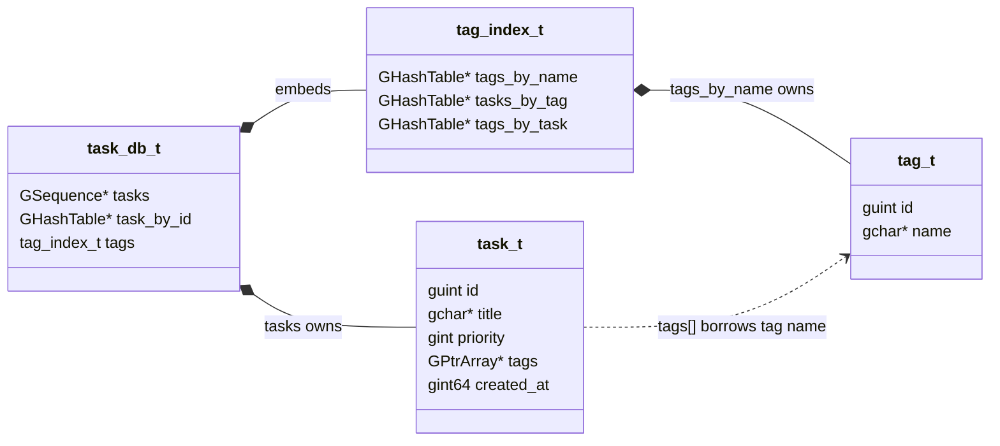

# task_db_t Structure

## Who owns what

Solid diamond = owns and frees. Dotted arrow = borrows a pointer, never frees.

## Tables

Each table is a `GHashTable`. Inner sets are `GHashTable`s used as sets
(`g_hash_table_add`), so each member is stored as its own key.

| Table          | Key                  | Value                         | Owns          |
| -------------- | -------------------- | ----------------------------- | ------------- |
| `task_by_id`   | task id              | `GSequenceIter*` into `tasks` | nothing       |
| `tags_by_name` | `tag->name` (string) | `tag_t*`                      | the `tag_t`   |
| `tasks_by_tag` | `tag_t*` (pointer)   | set of task ids               | the inner set |
| `tags_by_task` | task id              | set of `tag_t*`               | the inner set |

`task_t.tags` is a `GPtrArray` of `tag->name` pointers. It owns nothing.

## How a tag is identified

| Identity         | Used by                                                                      |
| ---------------- | ---------------------------------------------------------------------------- |
| name (string)    | outside callers; `tags_by_name` is the only place a name becomes a `tag_t*`  |
| `tag_t*` pointer | internal key of `tasks_by_tag`, member of the sets in `tags_by_task`         |
| task id          | key of `task_by_id` and `tags_by_task`, member of the sets in `tasks_by_tag` |

`tag->id` is not used as a key anywhere.

## Lifetime rule

A `tag_t*` used as a key or set member must be removed from `tasks_by_tag` and
from every tag set **before** it is removed from `tags_by_name`. Removing it
from `tags_by_name` frees the tag and its name, which `task_t.tags` also points at.
